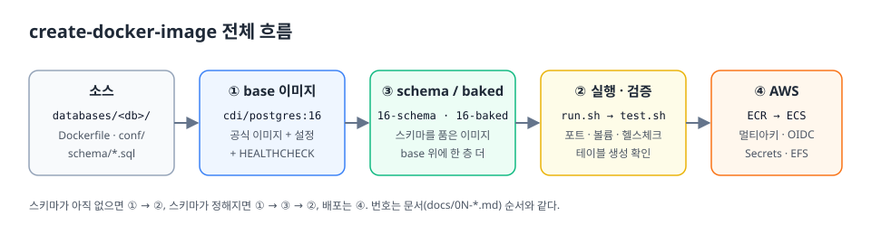

# create-docker-image

DB 종류별(PostgreSQL · MySQL · MariaDB · MongoDB · Redis) Docker 이미지를 만들고,
**스키마를 포함한 이미지**로 확장하고, **AWS(ECR · ECS Fargate)** 에 올려 실행하기까지의 과정을 정리한 저장소.



## 빠른 시작

```bash
cp .env.example .env                       # DB_PASSWORD 변경

bash scripts/build.sh postgres schema      # ① base → ③ schema 이미지 (cdi/postgres:16-schema)
bash scripts/run.sh   postgres schema      # ② 실행 (localhost:5432)
bash scripts/test.sh  postgres schema      # ② 검증 → PASS: 스키마 확인 → orders,users
bash scripts/stop.sh  postgres schema --purge

bash scripts/push-ecr.sh postgres          # ④ ECR 푸시 (amd64 + arm64)
```

`make`가 있으면 `make schema DB=mysql`, `make run DB=mysql VARIANT=schema`처럼 써도 된다.

## 단계별 문서

| 단계 | 문서 | 내용 |
|---|---|---|
| ① | [DB별 이미지 만들기](docs/01-build.md) | 공식 이미지 + 설정 + 헬스체크 → `cdi/<db>:<ver>` |
| ② | [사용법](docs/02-usage.md) | 실행 · 접속 · 검증 · compose · 정리 · 자주 겪는 문제 |
| ③ | [스키마를 포함한 이미지](docs/03-schema.md) | `schema`(첫 기동 때 초기화) vs `baked`(빌드 때 초기화 완료) |
| ④ | [AWS](docs/04-aws.md) | ECR 푸시(OIDC · 멀티아키) → ECS Fargate(EFS · Secrets Manager) |

## 지원 매트릭스

| DB | 버전 | base | schema | baked | 기본 포트 |
|---|---|:-:|:-:|:-:|---|
| PostgreSQL | 16 (alpine) | ✅ | ✅ | ✅ | 5432 |
| MySQL | 8.4 LTS | ✅ | ✅ | ✅ | 3306 |
| MariaDB | 11.4 LTS | ✅ | ✅ | – | 3306 |
| MongoDB | 7.0 | ✅ | ✅ (검증 규칙 + 인덱스) | – | 27017 |
| Redis | 7.4 (alpine) | ✅ | – (스키마 개념 없음) | – | 6379 |

이미지 태그 규칙: `cdi/<db>:<ver>` (base), `<ver>-schema`, `<ver>-baked`, ECR에는 추적용 `<ver>-<git-sha>`가 추가된다.

## 구조

```
.
├── databases/<db>/        # Dockerfile, Dockerfile.schema, Dockerfile.baked, conf/, schema/
├── scripts/
│   ├── lib.sh             # 버전 · 포트 · 태그 규칙 (한 곳에서 관리)
│   ├── build.sh           # 로컬 빌드
│   ├── run.sh / stop.sh   # 실행 · 정리
│   ├── test.sh            # healthy 대기 + 스키마 확인
│   └── push-ecr.sh        # ECR 멀티아키 푸시
├── aws/
│   ├── ecr-lifecycle-policy.json
│   ├── ecs/postgres-task-definition.json
│   └── iam/               # OIDC 신뢰 정책, ECR 푸시, ECS 실행/태스크 역할
├── .github/workflows/build-push-ecr.yml
└── docs/                  # 단계별 문서 + 다이어그램(images/)
```

## 원칙

- **비밀값은 커밋하지 않는다.** 로컬은 `.env`, 빌드는 BuildKit secret, AWS는 Secrets Manager, CI는 OIDC(키 없음).
- **공식 이미지를 확장한다.** 엔트리포인트를 재사용하고 우리는 설정 · 헬스체크 · 스키마만 책임진다.
- **스크립트는 bash.** Windows(Git Bash)와 Linux CI에서 같은 스크립트가 그대로 돈다.
