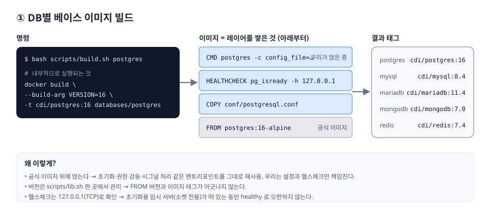

# ① DB별 이미지 만들기 (base)



## 무엇을 만드나

| DB | 공식 이미지 | 결과 태그 | 우리가 얹은 것 |
|---|---|---|---|
| PostgreSQL | `postgres:16-alpine` | `cdi/postgres:16` | `postgresql.conf`(listen `*`, KST, 슬로우쿼리 로그), `pg_isready` 헬스체크 |
| MySQL | `mysql:8.4` | `cdi/mysql:8.4` | `my.cnf`(utf8mb4, +09:00, 슬로우쿼리 로그), `mysqladmin ping` 헬스체크 |
| MariaDB | `mariadb:11.4` | `cdi/mariadb:11.4` | `my.cnf`, 내장 `healthcheck.sh` |
| MongoDB | `mongo:7.0` | `cdi/mongodb:7.0` | `TZ`, `mongosh ping` 헬스체크 |
| Redis | `redis:7.4-alpine` | `cdi/redis:7.4` | `redis.conf`(AOF, maxmemory), **비밀번호 필수** 래퍼, `PING` 헬스체크 |

버전은 [`scripts/lib.sh`](../scripts/lib.sh)의 `db_version()` 한 곳에서만 바꾼다.

## 빌드

```bash
bash scripts/build.sh postgres     # → cdi/postgres:16
bash scripts/build.sh mysql        # → cdi/mysql:8.4
make build-all                     # 5종 전부
```

이미지 이름 접두사는 `.env`의 `IMAGE_PREFIX`(기본 `cdi`)로 바꾼다.

## 디렉터리 구조

```
databases/<db>/
├── Dockerfile          # ① base
├── Dockerfile.schema   # ③-A 스키마 동봉 (redis 제외)
├── Dockerfile.baked    # ③-B 스키마 미리 적용 (postgres, mysql)
├── conf/               # DB 설정 파일
└── schema/             # 초기화 스크립트 (*.sql / *.js / *.sh)
```

## 설계 포인트

- **공식 이미지를 확장한다.** 처음부터 DB를 설치하지 않고 `FROM postgres:16-alpine` 위에 설정만 얹는다.
  공식 엔트리포인트가 하는 일(initdb, 권한 강등, `docker-entrypoint-initdb.d` 실행, 시그널 처리)을 그대로 쓸 수 있고,
  보안 패치는 베이스 태그를 다시 받아 빌드하면 끝난다.
- **헬스체크는 TCP로 한다.** 초기화 중에는 엔트리포인트가 "소켓 전용 임시 서버"를 띄워 스키마를 실행한다.
  소켓으로 핑하면 이 임시 서버에 성공해 버려서, 스키마가 다 들어가기 전에 `healthy`가 된다.
  `-h 127.0.0.1`로 확인하면 진짜 서버가 뜬 뒤에야 `healthy`가 된다.
- **Redis는 비밀번호를 강제한다.** 비밀번호 없이 `0.0.0.0`에 열린 Redis는 대표적인 침해 경로다.
  `cdi-entrypoint.sh`가 `REDIS_PASSWORD`가 없으면 기동을 거부한다.
- **`.gitattributes`로 LF를 강제한다.** Windows에서 CRLF로 체크아웃된 `.sh`가 이미지에 들어가면
  `/bin/sh^M: not found`로 컨테이너가 바로 죽는다.

## 변경하고 싶을 때

- 설정만 바꾸기: `databases/<db>/conf/` 수정 → 다시 빌드
- 메이저 버전 올리기: `lib.sh`의 버전 수정 → 다시 빌드.
  **기존 볼륨의 데이터는 메이저 업그레이드가 자동으로 되지 않는다** (PostgreSQL은 `pg_upgrade`나 dump/restore가 필요하다).
