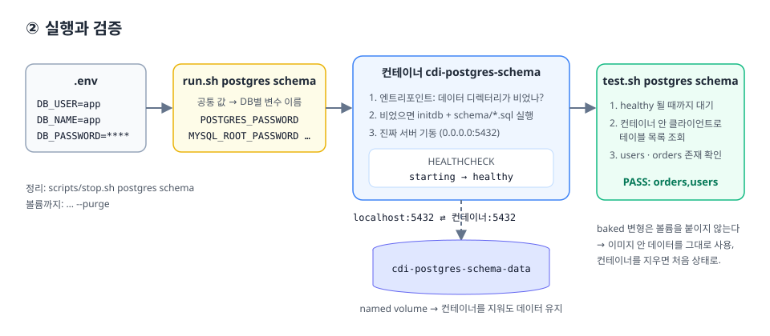

# ② 사용법 (실행 · 접속 · 검증 · 정리)



## 0. 준비

```bash
cp .env.example .env      # DB_PASSWORD 를 꼭 바꾼다 (.env 는 커밋되지 않음)
```

- Docker Desktop(또는 Docker Engine 23+, BuildKit 기본 활성)
- Windows는 Git Bash에서 실행한다 (`scripts/lib.sh`가 `MSYS_NO_PATHCONV=1`로 경로 변환 문제를 막는다)

## 1. 실행

```bash
bash scripts/build.sh postgres
bash scripts/run.sh postgres            # 컨테이너 cdi-postgres-base, localhost:5432
HOST_PORT=15432 bash scripts/run.sh postgres   # 포트가 겹치면
```

`.env`의 공통 값이 DB마다 다른 환경변수 이름으로 바뀌어 들어간다.

| .env | postgres | mysql | mariadb | mongodb | redis |
|---|---|---|---|---|---|
| `DB_USER` | `POSTGRES_USER` | `MYSQL_USER` | `MARIADB_USER` | `MONGO_INITDB_ROOT_USERNAME` | - |
| `DB_NAME` | `POSTGRES_DB` | `MYSQL_DATABASE` | `MARIADB_DATABASE` | `MONGO_INITDB_DATABASE` | - |
| `DB_PASSWORD` | `POSTGRES_PASSWORD` | `MYSQL_PASSWORD` + `MYSQL_ROOT_PASSWORD` | `MARIADB_PASSWORD` + `MARIADB_ROOT_PASSWORD` | `MONGO_INITDB_ROOT_PASSWORD` | `REDIS_PASSWORD` |

데이터는 named volume `cdi-<db>-<variant>-data`에 저장되므로 컨테이너를 지워도 남는다.

## 2. 검증

```bash
bash scripts/test.sh postgres           # healthy 대기 → 접속 확인
bash scripts/test.sh postgres schema    # + users/orders 테이블 존재 확인
```

## 3. 접속

```bash
# 컨테이너 안 클라이언트로 (호스트에 클라이언트 설치 불필요)
docker exec -it cdi-postgres-base psql -U app -d app
docker exec -it cdi-mysql-base    mysql -u app -p app
docker exec -it cdi-mariadb-base  mariadb -u app -p app
docker exec -it cdi-mongodb-base  mongosh -u app -p --authenticationDatabase admin app
docker exec -it cdi-redis-base    redis-cli -a "$DB_PASSWORD"
```

애플리케이션 연결 문자열 예시:

```
postgresql://app:<password>@localhost:5432/app
jdbc:mysql://localhost:3306/app
mongodb://app:<password>@localhost:27017/app?authSource=admin
redis://:<password>@localhost:6379/0
```

## 4. docker compose 로 쓰기

스크립트 대신 compose로 앱과 함께 띄울 수도 있다.

```yaml
services:
  db:
    image: cdi/postgres:16-schema
    environment:
      POSTGRES_USER: app
      POSTGRES_DB: app
      POSTGRES_PASSWORD: ${DB_PASSWORD}
    ports: ["5432:5432"]
    volumes: [pgdata:/var/lib/postgresql/data]
  app:
    image: my-app
    depends_on:
      db:
        condition: service_healthy   # 이미지에 넣은 HEALTHCHECK 를 그대로 활용
volumes:
  pgdata:
```

## 5. 정리

```bash
bash scripts/stop.sh postgres            # 컨테이너만 삭제 (데이터 유지)
bash scripts/stop.sh postgres base --purge   # 볼륨까지 삭제 → 다음 기동 때 초기화가 다시 돈다
```

## 자주 겪는 문제

| 증상 | 원인 | 해결 |
|---|---|---|
| 스키마를 바꿨는데 반영이 안 됨 | 초기화 스크립트는 **데이터 디렉터리가 비어 있을 때만** 실행된다 | `stop.sh <db> schema --purge` 후 재실행, 또는 마이그레이션 도구 사용 |
| `port is already allocated` | 호스트에 같은 DB가 이미 떠 있음 | `HOST_PORT=15432` 지정 |
| redis 컨테이너가 바로 종료 | `REDIS_PASSWORD` 없음 | `.env`의 `DB_PASSWORD` 확인 |
| `/bin/sh^M: not found` | CRLF 줄바꿈 | `git add --renormalize .` 후 다시 빌드 |
