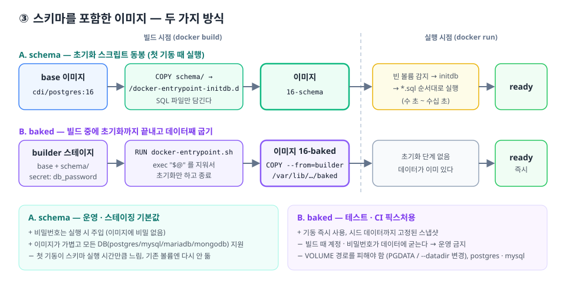

# ③ 스키마가 정해졌을 때 — 스키마를 포함한 이미지



스키마를 이미지에 넣는 방법은 두 가지이고, 목적이 다르다.

| | A. `schema` (권장 기본값) | B. `baked` |
|---|---|---|
| 넣는 것 | SQL/JS **파일** | 초기화가 끝난 **데이터 디렉터리** |
| 스키마 실행 시점 | 컨테이너 **첫 기동** | 이미지 **빌드** |
| 기동 속도 | 스키마 실행 시간만큼 느림 | 즉시 |
| 비밀번호 | 실행 시 주입 | 빌드 때 데이터에 굳음 |
| 용도 | 개발 · 스테이징 · 운영 | 테스트 · CI 픽스처 |
| 지원 | postgres, mysql, mariadb, mongodb | postgres, mysql |

## 1. 스키마 파일 넣기

`databases/<db>/schema/`에 파일을 넣는다. **파일명 순서대로** 실행되므로 번호를 붙인다.

```
databases/postgres/schema/
├── 01-schema.sql   # CREATE TABLE ...
└── 02-seed.sql     # INSERT ... (선택)
```

- `.sql`, `.sql.gz`, `.sh`는 postgres/mysql/mariadb, `.js`, `.sh`는 mongodb에서 실행된다
- 접속 대상 DB는 실행 시 환경변수(`POSTGRES_DB`, `MYSQL_DATABASE` …)로 정해지므로 SQL에 DB 이름을 적지 않는다
- 여러 번 실행돼도 안전하도록 `IF NOT EXISTS`, `ON CONFLICT DO NOTHING`, `INSERT IGNORE`를 쓴다
- 다른 디렉터리를 쓰려면 `SCHEMA_DIR=schema-v2 bash scripts/build.sh postgres schema`
  (빌드 컨텍스트가 `databases/<db>/`이므로 그 안에 있어야 한다)

> MongoDB는 스키마리스지만 `01-init.js`에서 **컬렉션 + `$jsonSchema` 검증 규칙 + 인덱스**를 만들어
> "스키마"를 고정한다. 규칙에 맞지 않는 문서는 insert가 거부된다.

## 2-A. `schema` 이미지 (첫 기동 때 초기화)

```bash
bash scripts/build.sh postgres schema     # → cdi/postgres:16-schema (base가 없으면 먼저 빌드)
bash scripts/run.sh   postgres schema
bash scripts/test.sh  postgres schema     # PASS: 스키마 확인 → orders,users
```

[`Dockerfile.schema`](../databases/postgres/Dockerfile.schema)는 base 위에 파일을 복사하는 한 줄이다.

```dockerfile
ARG BASE_IMAGE=cdi/postgres:16
FROM ${BASE_IMAGE}
ARG SCHEMA_DIR=schema
COPY ${SCHEMA_DIR}/ /docker-entrypoint-initdb.d/
```

**왜 base와 분리했나?** 설정(base)과 스키마는 바뀌는 주기가 다르다.
여러 서비스가 같은 base를 공유하고 스키마만 다른 이미지를 만들 수 있고, 스키마만 바뀌면 마지막 레이어만 다시 빌드된다.

## 2-B. `baked` 이미지 (빌드 때 초기화 완료)

```bash
DB_PASSWORD=test-pass bash scripts/build.sh postgres baked   # → cdi/postgres:16-baked
bash scripts/run.sh  postgres baked
bash scripts/test.sh postgres baked
```

[`Dockerfile.baked`](../databases/postgres/Dockerfile.baked)의 핵심은 세 가지다.

1. **엔트리포인트를 "초기화만" 하게 만든다.** 마지막 줄 `exec "$@"`(서버 실행)를 `sed`로 지우고
   `RUN docker-entrypoint.sh postgres`를 실행하면, initdb → 스키마 실행 → 임시 서버 종료까지만 하고 빌드가 다음 단계로 넘어간다.
2. **VOLUME 경로를 피한다.** 공식 이미지는 `/var/lib/postgresql/data`(mysql은 `/var/lib/mysql`)를 `VOLUME`으로 선언한다.
   `VOLUME` 경로에 빌드 중 쓴 내용은 레이어에 남지 않으므로 `PGDATA=/var/lib/postgresql/baked`
   (mysql은 `--datadir=/var/lib/mysql-baked`)로 바꾼다.
3. **비밀번호는 BuildKit secret으로 넘긴다.** `--build-arg`는 `docker history`에 평문으로 남는다.
   `--secret id=db_password,env=DB_PASSWORD`는 빌드 중 `/run/secrets/db_password`에만 보인다.
   다만 **해시된 비밀번호는 데이터에 남으므로** baked 이미지는 테스트용으로만 쓴다.

멀티 스테이지 빌드로 builder에서 만든 데이터 디렉터리만 깨끗한 base 위로 `COPY --from=builder` 한다.

## 운영에서 스키마가 바뀐다면

초기화 스크립트는 **최초 1회**만 돈다. 이미 데이터가 있는 DB에 스키마 변경을 적용하는 건 이미지의 역할이 아니라
**마이그레이션 도구**(Flyway, Liquibase, Prisma Migrate, golang-migrate 등)의 역할이다.

- 이미지에 넣는 스키마 = "새 환경을 만들 때의 시작점"
- 마이그레이션 = "이미 돌고 있는 DB를 다음 버전으로 옮기는 절차"

권장 흐름은 마이그레이션 파일을 진실의 원천(source of truth)으로 두고, CI에서 마이그레이션을 적용한 결과를 baked 이미지로 구워
통합 테스트에 쓰는 것이다.
