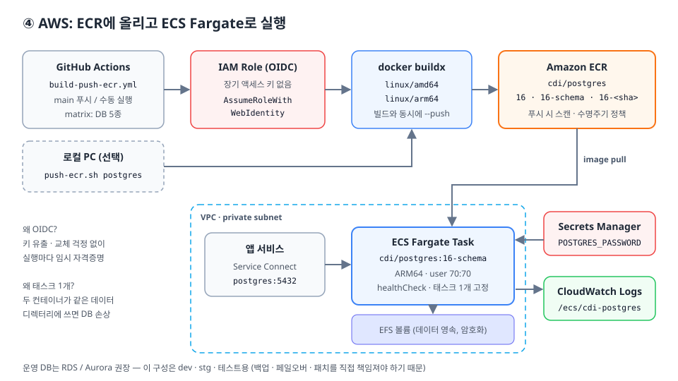

# ④ AWS — ECR에 올리고 ECS Fargate로 실행



> **먼저 결론:** 운영 DB는 **RDS / Aurora**가 맞다. 백업 · Multi-AZ 페일오버 · 패치 · 모니터링을 AWS가 대신 해 준다.
> 이 문서의 컨테이너 DB 구성은 **개발 · 스테이징 · 테스트 환경**이나, 같은 이미지를 로컬과 AWS에서 똑같이 쓰고 싶을 때를 위한 것이다.
> 단, 여기서 만든 **스키마 파일은 RDS에도 그대로** 적용할 수 있다 (`psql -h <rds-endpoint> -f schema/01-schema.sql`).

## 1. ECR에 이미지 올리기

### 1-1. 로컬에서

```bash
aws configure                          # 또는 aws sso login
# .env 에 AWS_REGION, AWS_ACCOUNT_ID 설정
bash scripts/push-ecr.sh postgres      # base + schema 를 linux/amd64,arm64 로 푸시
bash scripts/push-ecr.sh postgres base schema baked
PLATFORMS=linux/arm64 bash scripts/push-ecr.sh mysql
```

[`push-ecr.sh`](../scripts/push-ecr.sh)가 하는 일:

1. 저장소 `cdi/<db>`가 없으면 생성 — **푸시 시 취약점 스캔**, [수명주기 정책](../aws/ecr-lifecycle-policy.json)(태그 없는 이미지 7일, 최대 30개)
2. `aws ecr get-login-password`로 12시간짜리 토큰 로그인
3. `docker buildx`로 **amd64 + arm64**를 한 번에 빌드해 푸시. 태그는 `16`, `16-schema`와 추적용 `16-<git-sha>`

> **왜 멀티 아키텍처인가?** Fargate Graviton(ARM64)은 같은 성능에 x86보다 약 20% 저렴하다.
> 하나의 태그에 두 아키텍처를 담아 두면 Graviton과 x86 어느 쪽에서 실행하든 맞는 이미지를 알아서 받는다.

### 1-2. GitHub Actions에서 (OIDC, 키 없이)

[`.github/workflows/build-push-ecr.yml`](../.github/workflows/build-push-ecr.yml)은 `main`에서 `databases/**`가 바뀌면 5개 DB를 matrix로 푸시한다.
AWS 액세스 키를 GitHub Secrets에 넣지 않고, **GitHub이 발급한 OIDC 토큰으로 IAM Role을 잠깐 맡는다**.

한 번만 설정한다.

```bash
# (1) GitHub OIDC 공급자 등록 (계정당 1회)
aws iam create-open-id-connect-provider \
  --url https://token.actions.githubusercontent.com \
  --client-id-list sts.amazonaws.com

# (2) 역할 생성: main 브랜치에서 실행된 이 저장소의 워크플로만 맡을 수 있다
sed "s/<ACCOUNT_ID>/$AWS_ACCOUNT_ID/g" aws/iam/github-oidc-trust-policy.json > /tmp/trust.json
aws iam create-role --role-name cdi-github-ecr-push \
  --assume-role-policy-document file:///tmp/trust.json

# (3) 권한: cdi/* 저장소에만 푸시
sed -e "s/<ACCOUNT_ID>/$AWS_ACCOUNT_ID/g" -e "s/<REGION>/$AWS_REGION/g" \
  aws/iam/ecr-push-policy.json > /tmp/ecr-push.json
aws iam put-role-policy --role-name cdi-github-ecr-push \
  --policy-name ecr-push --policy-document file:///tmp/ecr-push.json
```

GitHub 저장소 → Settings → Secrets and variables → Actions → **Variables**에 추가한다.

| 이름 | 값 |
|---|---|
| `AWS_ROLE_ARN` | `arn:aws:iam::<ACCOUNT_ID>:role/cdi-github-ecr-push` |
| `AWS_REGION` | `ap-northeast-2` |
| `AWS_ACCOUNT_ID` | 12자리 계정 ID |

`AWS_ROLE_ARN`이 없으면 워크플로는 실패하지 않고 푸시 단계를 건너뛴다.

## 2. ECS Fargate로 실행 (PostgreSQL 예시)

구성: private subnet의 Fargate 태스크 1개 + EFS(데이터) + Secrets Manager(비밀번호) + CloudWatch Logs.

```bash
export AWS_REGION=ap-northeast-2 AWS_ACCOUNT_ID=123456789012

# (1) 비밀번호 → Secrets Manager (태스크 정의에는 ARN만 들어간다)
aws secretsmanager create-secret --name cdi/postgres/password --secret-string "$DB_PASSWORD"

# (2) EFS + 액세스 포인트: postgres(alpine) 유저 uid/gid 70 소유의 /postgres 디렉터리
EFS_ID=$(aws efs create-file-system --encrypted --tags Key=Name,Value=cdi-postgres \
  --query FileSystemId --output text)
#     태스크가 뜰 서브넷마다 마운트 타깃 생성 (보안그룹은 2049/tcp 를 태스크 SG 에서만 허용)
aws efs create-mount-target --file-system-id "$EFS_ID" --subnet-id subnet-aaa --security-groups sg-efs
AP_ID=$(aws efs create-access-point --file-system-id "$EFS_ID" \
  --posix-user Uid=70,Gid=70 \
  --root-directory 'Path=/postgres,CreationInfo={OwnerUid=70,OwnerGid=70,Permissions=700}' \
  --query AccessPointId --output text)

# (3) 로그 그룹
aws logs create-log-group --log-group-name /ecs/cdi-postgres

# (4) 역할: 실행 역할(이미지 pull·시크릿·로그) / 태스크 역할(EFS 마운트)
#     실행 역할 = AmazonECSTaskExecutionRolePolicy + aws/iam/ecs-execution-secrets-policy.json
#     태스크 역할 = aws/iam/ecs-task-role-policy.json

# (5) 태스크 정의 등록 (자리표시자 치환)
sed -e "s/<ACCOUNT_ID>/$AWS_ACCOUNT_ID/g" -e "s/<REGION>/$AWS_REGION/g" \
    -e "s/<EFS_ID>/$EFS_ID/g" -e "s/<EFS_ACCESS_POINT_ID>/$AP_ID/g" \
    aws/ecs/postgres-task-definition.json > /tmp/taskdef.json
aws ecs register-task-definition --cli-input-json file:///tmp/taskdef.json

# (6) 서비스 생성: 항상 1개, 배포 중에도 동시에 2개가 뜨지 않게
aws ecs create-cluster --cluster-name cdi
aws ecs create-service --cluster cdi --service-name cdi-postgres \
  --task-definition cdi-postgres --desired-count 1 --launch-type FARGATE \
  --deployment-configuration 'maximumPercent=100,minimumHealthyPercent=0' \
  --network-configuration 'awsvpcConfiguration={subnets=[subnet-aaa],securityGroups=[sg-db],assignPublicIp=DISABLED}'
```

### 태스크 정의에서 눈여겨볼 곳 ([`postgres-task-definition.json`](../aws/ecs/postgres-task-definition.json))

| 항목 | 값 | 이유 |
|---|---|---|
| `runtimePlatform.cpuArchitecture` | `ARM64` | Graviton — 멀티 아키로 올려 두었기 때문에 가능 |
| `secrets[].valueFrom` | Secrets Manager ARN | 태스크 정의 · 콘솔 어디에도 평문 비밀번호가 남지 않는다 |
| `user` | `70:70` | EFS 액세스 포인트가 uid 70으로 강제 → 컨테이너도 같은 uid로 실행해 `chown` 없이 쓰기 가능 |
| `PGDATA` | `.../data/pgdata` | 마운트 지점 바로 아래가 아닌 하위 디렉터리를 써야 initdb가 "비어 있지 않음" 오류를 내지 않는다 |
| `deploymentConfiguration` | `max 100 / min 0` | 롤링 배포 중 **두 postgres가 같은 데이터 디렉터리에 쓰면 DB가 손상**된다 → 기존 태스크를 먼저 내린다 |
| `stopTimeout` | `60` | 종료 시 체크포인트를 끝낼 시간을 준다 (기본 30초) |

### 네트워크

- 태스크는 **private subnet**, 보안그룹은 5432/tcp를 **앱 서비스의 보안그룹에서만** 허용한다
- 앱은 ECS **Service Connect**(또는 Cloud Map)로 `postgres:5432`처럼 이름으로 접속한다 (태스크 IP는 재시작마다 바뀐다)
- NAT 없이 쓰려면 VPC 엔드포인트가 필요하다: `ecr.api`, `ecr.dkr`, `s3`(gateway), `logs`, `secretsmanager`, `elasticfilesystem`

### 한계 (그래서 운영은 RDS)

- EFS는 NFS다. 쓰기 지연이 로컬 디스크보다 커서 쓰기가 많은 부하에는 맞지 않는다
- 백업은 AWS Backup으로 EFS 스냅샷을 걸 수 있지만, DB 일관성까지 보장하려면 `pg_dump` 크론을 따로 두는 편이 안전하다
- 페일오버 없음: 태스크가 죽으면 ECS가 다시 띄우는 동안(수십 초~수 분) 접속할 수 없다

## 3. 가장 간단한 대안: EC2 한 대

ECS까지 필요 없으면 EC2 인스턴스 프로파일에 `AmazonEC2ContainerRegistryReadOnly`를 붙이고 바로 실행한다.

```bash
aws ecr get-login-password --region ap-northeast-2 \
  | docker login --username AWS --password-stdin 123456789012.dkr.ecr.ap-northeast-2.amazonaws.com
docker run -d --name db --restart unless-stopped -p 5432:5432 \
  -e POSTGRES_USER=app -e POSTGRES_DB=app \
  -e POSTGRES_PASSWORD="$(aws secretsmanager get-secret-value --secret-id cdi/postgres/password --query SecretString --output text)" \
  -v pgdata:/var/lib/postgresql/data \
  123456789012.dkr.ecr.ap-northeast-2.amazonaws.com/cdi/postgres:16-schema
```

데이터는 EBS에 남고, EBS 스냅샷(Data Lifecycle Manager)으로 백업한다.
